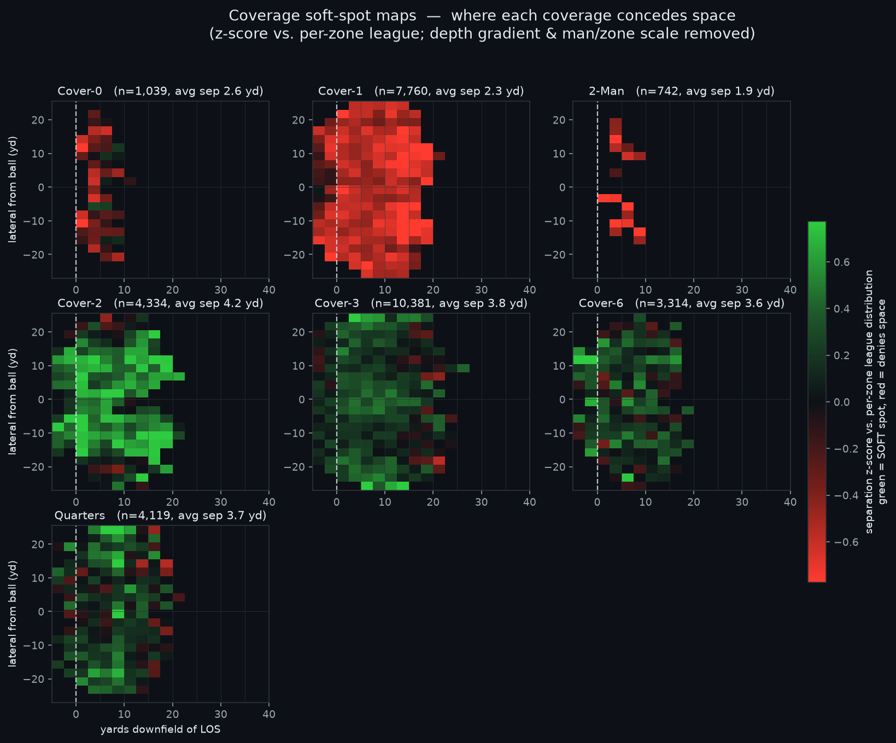

# Soft Spots: Where Coverages Concede Space to Skill-Position Receivers

A geometric, scheme-level map of where each NFL defensive coverage gives up receiver
separation — built from player tracking with linear algebra, not a trained model.

### ▶ Interactive app: **https://shreyas-nyu.github.io/nfl_big_data_bowl/**
Pick a coverage and skill position; the soft-spot field, the "who attacks it" bars, and
the recommended call update live. (Self-contained — served from `docs/` on GitHub Pages.)



## Summary (findings, methods, assumptions, limitations)

**Findings.** Using 33,018 routes across 122 games (2021, Weeks 1–8), we map where each
coverage concedes separation to WR/TE/RB at the moment of the throw, and find the maps
match football intuition (man coverage denies space everywhere; Cover-2 is soft in the
intermediate and deep-sideline holes; Cover-3 is soft underneath but tight deep), with
each skill position finding space in *different* zones against the same coverage.
**Methods.** We treat every player as a kinematic vector from the tracking data and
compute, purely geometrically, each receiver's nearest-defender separation (headline
metric) and field-bounded Voronoi controlled area; separation is standardized per field
zone (z-score vs. the league distribution) to isolate coverage-specific soft spots, and
an unsupervised SVD of the per-coverage surfaces recovers the man-vs-zone split as its
largest mode (75% of variance, r = −0.80 with man/zone) *without being given the labels*.
**Assumptions.** We measure at the throw (`pass_forward`, ~90% of plays; snap+2.5s
fallback otherwise), normalize all plays left-to-right and relative to the line of
scrimmage, use PFF's post-hoc coverage labels as ground truth, and treat nearest-defender
distance as the separation proxy.
**Limitations.** Coverage labels can misclassify disguised looks; nearest-defender
distance ignores zone pass-offs; rarer coverages (2-Man, Cover-0) have smaller samples;
and the map describes where throws *succeed*, not the QB's intended read, since targets
are observed but intended reads are not (validated: completions land in softer zones,
p ≈ 4e-30).

## What's in here

| Output | What it shows |
|---|---|
| `outputs/softspot_maps.png` | **Headline** — soft-spot z-score map per coverage |
| `outputs/skill_softspots_*.png` | Skill-position cut (WR / TE / RB) per coverage |
| `outputs/svd_overview.png` | Unsupervised SVD recovering the man/zone axis |
| `outputs/separation_surfaces.png` | Raw separation by coverage |
| `outputs/route_separations_throw.parquet` | Cached route-level dataset |

## Reproduce

```bash
python -m venv .venv && source .venv/bin/activate
pip install pandas numpy matplotlib scipy scikit-learn pyarrow

# 1. download tracking into data/tracking/ (122 files), alongside the 4 metadata CSVs
# 2. build the route dataset (~5 min)
python -m src.build_dataset
# 3. figures + validation
python -m src.visualize          # soft-spot + skill maps
python -m src.validate_targets   # Test 1
python -m src.plot_svd           # SVD moat figure
```

Or run `notebook.ipynb` end to end.

## Why it's different

Public products (NGS separation, ESPN Open Score, PFF/NGS decision and completion-
probability models) are **player-centric** and built on **trained models**. This is
**field-centric** (it grades the *scheme's* geometry, not a player) and **transparent**
(every value traces to positions and a linear-algebra operation a coach can audit).

## Pipeline

```
src/geometry.py   kinematic vectors, separation, closing speed, field-bounded Voronoi area
src/loader.py     joins + LOS-relative extraction (validated snap->throw anchors)
src/surface.py    spatial aggregation + per-zone z-score soft-spot surfaces
src/targets.py    parse target/outcome from playDescription
src/visualize.py  dark-mode separation + soft-spot + skill-position maps
src/decompose.py  SVD of coverage surfaces (unsupervised structure)
src/validate_targets.py  Test 1: targets/completions land in soft zones
```
